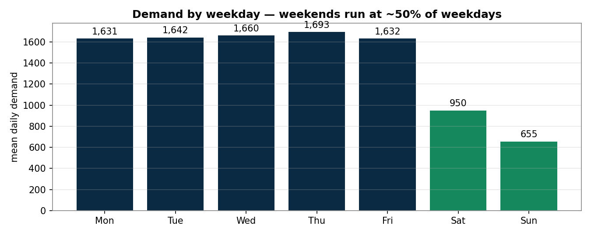
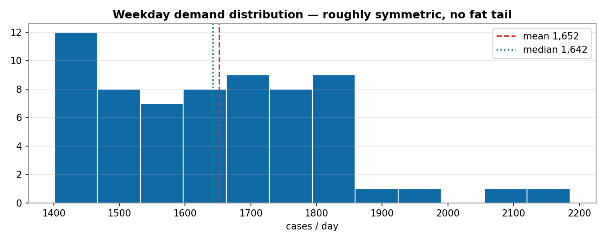
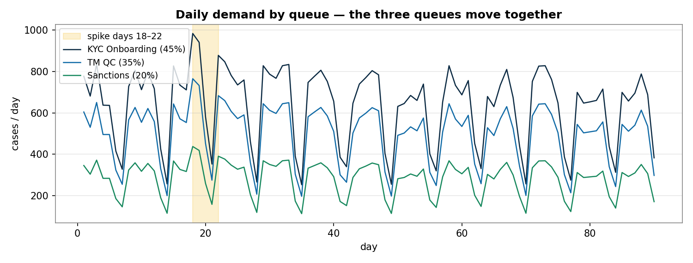

# EDA — what the numbers actually look like

Small exploratory analysis of the 90-day synthetic history
(`data/raw/demand_daily.csv`, `data/raw/demand_by_queue.csv`, seed 42).
Everything below is computed from those files, not asserted.

## The dataset — what each record is

Two files, one grain each. All 90 days are calendar days from
**Mon 2026-01-05 to Sat 2026-04-04**: 65 business days (Mon–Fri) and
25 weekend days.

### File 1: `demand_daily.csv` — one row per day (90 rows)

One record = one day of operation for the whole team.

| Column | What it is | Example (day 1) |
|---|---|---|
| `day` | Day number, 1–90 | 1 |
| `date` | Calendar date | 2026-01-05 |
| `weekday` | Mon–Sun | Mon |
| `demand` | Cases arriving that day | 1,727 |
| `analysts_scheduled` | Analysts rostered that day | 403 |
| `absent` | Analysts absent that day | 21 |
| `analysts` | Available = scheduled − absent | 382 |
| `productivity` | Cases completed per available analyst | 4.82 |
| `capacity` | Cases the team could complete = analysts × productivity | 1,841 |
| `completed` | Cases actually completed (≤ capacity, ≤ backlog + demand) | 1,727 |
| `backlog` | Cases left uncompleted at end of day | 0 |
| `sla_ok` | True when backlog < 5,000 | True |

Totals over 90 days: demand **127,553** cases, completed **127,553**
(everything that arrived was eventually completed — ending backlog is
0), capacity **146,566** (about 15% headroom over demand on average).

### File 2: `demand_by_queue.csv` — one row per day per queue (270 rows)

One record = one day for one queue. Same 90 days × 3 queues.

| Queue (category) | SLA | Rows | Total demand | Share | Backlog-days* |
|---|---|---|---|---|---|
| KYC Onboarding | 5 days | 90 | 57,399 | 45.0% | 2,127 |
| Transaction Monitoring QC | 5 days | 90 | 44,642 | 35.0% | 1,655 |
| Sanctions Screening | 2 days | 90 | 25,510 | 20.0% | 947 |

\*Backlog-days = sum of the daily backlog column over 90 days, not the
ending backlog. The per-queue backlog is a **pro-rata allocation** of
the total backlog by each queue's share of demand — a transparent
placeholder, not a claim about real per-queue backlogs (see
`docs/metric-definitions.md`). Sanctions is the tightest SLA (2 days)
with the smallest share — the queue to watch first if backlog builds.

Example rows (day 22, 2026-01-26, spike day): KYC demand 878 /
backlog 370; TM QC 683 / 288; Sanctions 390 / 165.

### Categories in the data

- **Queues:** 3 (above), each with its own SLA in days.
- **Weekdays:** 7 (Mon–Sun); the planning grain is Mon–Fri.
- **SLA outcome:** `sla_ok` True on 90/90 days in both files.
- **Spike flag:** days 18–22 (demand +25%) — 5 calendar days, 3 of
  them weekdays.

## Data quality checks — run before any analysis

A robust EDA checks the data before trusting it. All checks below were
run on the two files and passed:

| Check | Result |
|---|---|
| Null / empty cells | 0 in both files |
| Duplicate dates (`demand_daily`) | 0 |
| Duplicate day+queue (`demand_by_queue`) | 0 |
| Date gaps | None — 90 consecutive days |
| `analysts = scheduled − absent` | 0 violations |
| `capacity = analysts × productivity` | 0 violations |
| `completed > capacity` | 0 violations |
| Negative values | None |
| Queue demand reconciles to daily demand | ±1 case on 32 days — integer rounding from the 45/35/20 split, net −2 cases over 90 days. Immaterial. |

Two more numbers that frame the operation: absent rate mean 6.8%
(range 5.1–9.0%, 15 days above 8%); utilisation mean 87.0%, 25 days
above 95%, 17 days at 100%. And the trend inside the history:
weekday demand averaged 1,726 in the first 30 business days vs 1,575
in the last 30 (−8.8%) — consistent with the measured OLS trend of
−4.01%/month reported in the forecast, and the reason the trend is
reported but not auto-applied.

## The shape of the data

| Variable | Mean | Median | Std | Min | Max |
|---|---|---|---|---|---|
| Demand / day | 1,417 | 1,536 | 415 | 560 | 2,186 |
| Capacity / day | 1,629 | 1,826 | 454 | 671 | 2,090 |
| Completed / day | 1,417 | 1,536 | 422 | 560 | 2,068 |
| Productivity (cases/analyst/day) | 5.0 | 5.0 | 0.2 | 4.6 | 5.4 |
| Analysts available / day | 326 | 377 | 91 | 142 | 398 |
| Absent / day | 24 | 25 | 8 | 8 | 37 |
| Backlog | 53 | 0 | 170 | 0 | 853 |

Read it carefully: the overall means mix weekdays and weekends, so they
understate the working week. Weekday demand averages ~1,650/day; the
forecast correctly uses weekday averages only (base 1,575/day on the
last 30 business days).

## Weekday effect — the biggest pattern in the data

- Mon–Fri: 1,631 / 1,642 / 1,660 / 1,693 / 1,632 (flat across the week)
- Sat: 950, Sun: 655 — weekends run at ~50% of weekdays

There is no Monday spike and no Friday dip. The weekday effect is
weekday-vs-weekend only, which is why the forecast uses weekday
averages and not a 7-day average.

## Demand distribution (weekdays)

Roughly symmetric around the mean, no fat tail, no second mode. The
risk in this operation does not come from a wild demand distribution —
it comes from utilisation running at 87%, close to the edge, so a
normal-sized move swings the backlog a lot.

## The spike

- Spike days 18–22 (weekdays): mean demand 2,076 vs 1,631 on other
  weekdays — **+27.3%**, matching the designed +25% spike.
- Backlog peaked at 853 and cleared in about a week.
- Only 17 of 90 days had any backlog at all; 5 days above 500.
  Backlog is zero-inflated: median 0, mean 53.

## Queues

- KYC Onboarding 45.0% (SLA 5 days), Transaction Monitoring QC 35.0%
  (SLA 5 days), Sanctions Screening 20.0% (SLA 2 days).
- The split is exact by design. Sanctions is the tightest SLA with the
  smallest share — the queue to watch first if backlog ever builds.

## Correlations (daily, Pearson) — and what not to conclude

| Pair | r |
|---|---|
| Demand vs completed | 0.99 |
| Analysts vs completed | 0.94 |
| Absent vs completed | 0.78 |
| Demand vs backlog | 0.15 |
| Productivity vs completed | −0.14 |
| Absent vs backlog | −0.02 |

- Demand vs completed 0.99 is trivial: when there is no backlog,
  completed ≈ demand by construction. It proves nothing about
  causality.
- Absent vs completed 0.78 is mostly a weekend artifact: weekends have
  fewer analysts scheduled and less demand. Do not read it as
  "absences drive completions".
- Demand vs backlog 0.15 is the interesting one: daily demand alone
  barely explains backlog. Backlog is driven by the *sustained* gap
  between demand and capacity (the spike window), not by any single
  day's demand. That is why the forecast is monthly and scenario-based,
  not a daily regression.
- SLA held on 90/90 days in history. The breach only appears in the
  forecast under a sustained surge — which is the whole point of the
  project.

## Demand by queue over time

The three queues move together — same shape, different scale. There is
no queue with its own season or its own spike: when demand jumps, it
jumps in all three at once, which is why a single team-level forecast
with a queue split is a reasonable model here. Weekday means: KYC 743
(±76), TM QC 578 (±59), Sanctions 330 (±34).

## Outlier days

Rule: weekday demand outside mean ± 2 standard deviations
(weekday mean 1,652, std 170 → bounds 1,312–1,991). Only 2 of 65
weekdays qualify — both at the start of the spike:

| Day | Date | Demand | z-score | Capacity | Backlog |
|---|---|---|---|---|---|
| 18 | 2026-01-22 | 2,186 | +3.15 | 2,033 | 153 |
| 19 | 2026-01-23 | 2,091 | +2.59 | 1,881 | 363 |

No weekday fell below the lower bound: there are no "quiet" outliers
in this history. The spike is the only outlier event.

Days with backlog above 500 (5 days) tell the second half of the
story — the backlog did not peak on the highest-demand day, it peaked
after it, when weekend capacity dropped:

| Day | Date | Backlog | Demand | Capacity |
|---|---|---|---|---|
| 20 | 2026-01-24 (Sat) | 609 | 1,288 | 1,042 |
| 21 | 2026-01-25 (Sun) | 717 | 783 | 675 |
| 22 | 2026-01-26 (Mon) | 823 | 1,951 | 1,845 |
| 23 | 2026-01-27 (Tue) | 853 | 1,882 | 1,852 |
| 24 | 2026-01-28 (Wed) | 520 | 1,735 | 2,068 |

Read: the backlog built over the weekend (low staffing) and cleared
once weekday capacity returned. Staffing the weekend is part of the
capacity decision, not just headcount.

## Honest weaknesses the EDA exposes

1. **Productivity barely varies** (std 0.2 on a mean of 5.0). The
   −10% productivity shock in the forecast is an assumption, not an
   observed regime. With real data, productivity by queue and tenure
   would be the first thing to calibrate.
2. **Backlog is mostly zero**, so any correlation with backlog is
   estimated on 17 days. The Monte Carlo and the interval carry the
   uncertainty for exactly this reason.
3. **No annual seasonality** can be estimated from 90 days. The
   weekday pattern is real; anything about Q4 vs Q1 would be invented.
